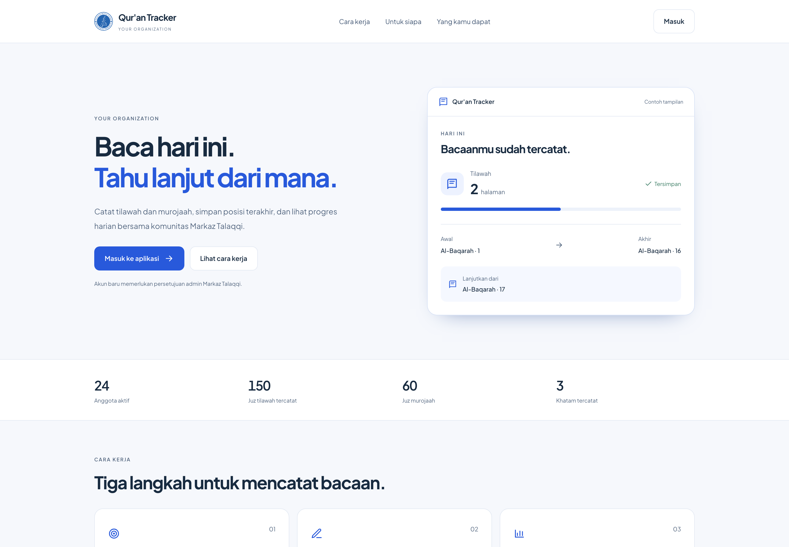

# Quran Tracker

Quran Tracker is a Bun + Hono web app for community Qur'an progress tracking. Members log daily tilawah and murojaah, follow streaks and targets, and compare progress on a monthly leaderboard.



*Screenshot uses demo data. Member names and activity numbers are generated.*

> Started from [mgilank/Quran-Tahfiz-Tracker](https://github.com/mgilank/Quran-Tahfiz-Tracker) and rewritten since. See [NOTICE](NOTICE).

## What it does

- Log tilawah and murojaah by juz or pages
- Track surah and ayah endpoints for each entry
- Set separate daily targets for tilawah and murojaah
- Show streaks, khatam milestones, and a rolling activity heatmap
- Rank members on a monthly leaderboard with archived snapshots
- Support admin approval, suspension, and role management
- Send email notifications for approvals, reminders, streaks, khatam, and snapshots
- Offer English and Indonesian UI

## Stack

| Layer | Technology |
|---|---|
| Runtime | [Bun](https://bun.sh) |
| Framework | [Hono](https://hono.dev) with JSX SSR |
| Database | SQLite via `bun:sqlite` |
| Styling | TailwindCSS (compiled from `src/input.css`) |
| Auth | Google OAuth 2.0 and email/password |

## Core behavior

- New accounts require admin approval before full access
- The first signed-in user becomes `super_admin`
- Khatam bonuses use strict boundary checks and once-per-day deduplication
- Leaderboard scoring is `Tilawah * 10 + Murojaah * 7 + Khatam * 300`
- Public entry points include `/landing` and `/login`. Program enrollment is no longer available.

## Local setup

### Requirements

- [Bun](https://bun.sh) 1.x
- Google OAuth credentials
- SMTP credentials if you want email features enabled

### Install

```bash
git clone https://github.com/srmdn/quran-tracker.git
cd quran-tracker
bun install
```

### Configure

Copy `.env.example` to `.env` and fill in the values you need:

```bash
cp .env.example .env
```

```env
GOOGLE_CLIENT_ID=your_google_client_id
GOOGLE_CLIENT_SECRET=your_google_client_secret
APP_URL=http://localhost:3000
PORT=3000
APP_NAME=Qur'an Tracker
ORG_NAME=Your Organization
PRODUCT_NAME=Qur'an Tracker
GOOGLE_REDIRECT_URI=http://localhost:3000/auth/google/callback

SMTP_HOST=smtp.example.com
SMTP_PORT=465
SMTP_USER=your_smtp_username
SMTP_PASS=your_smtp_password
SMTP_FROM=Your App Name <noreply@example.com>
SMTP_FROM_NAME=Your App Name
SMTP_REJECT_UNAUTHORIZED=true
```

Set your Google OAuth redirect URI to:

```text
http://localhost:3000/auth/google/callback
```

### Run

```bash
bun run dev
```

Or run the production entrypoint locally:

```bash
bun run start
```

The server binds to `127.0.0.1` by default and uses `PORT` from the environment.

## Scheduled jobs

```bash
bun run src/jobs/daily-reminder.ts
bun run snapshot:monthly
```

Optional monthly override:

```bash
SNAPSHOT_YEAR=2026 SNAPSHOT_MONTH=1 bun run snapshot:monthly
```

## Project layout

```text
src/
  index.tsx          App entrypoint
  config.ts          Environment-driven config
  db/                SQLite connection and schema
  routes/            Hono route handlers
  lib/               Business logic, email, auth, helpers
  views/             SSR pages and UI components
data/
  ngaji.db           SQLite database file
public/
  logo.png           App logo and default social image
```

## Notes

- Static assets are served from `/public/*`
- Styling is compiled with `bun run build:css`; regenerate `public/tailwind.css` after changing Tailwind classes
- SQLite tables are initialized on startup
- Expired sessions are cleaned on startup
- Run `bun test` for unit tests and `bunx tsc --noEmit` for typechecking

## Contributing

See [CONTRIBUTING.md](CONTRIBUTING.md). License: [MIT](LICENSE) for original
contributions; see [NOTICE](NOTICE) for inherited material.

## Attribution

This project started as a copy of
[mgilank/Quran-Tahfiz-Tracker](https://github.com/mgilank/Quran-Tahfiz-Tracker),
which did not include a license file. The original author keeps all rights to
the code they wrote. Everything added or rewritten since is MIT licensed under
this repository.

See [NOTICE](NOTICE) for the full statement.
